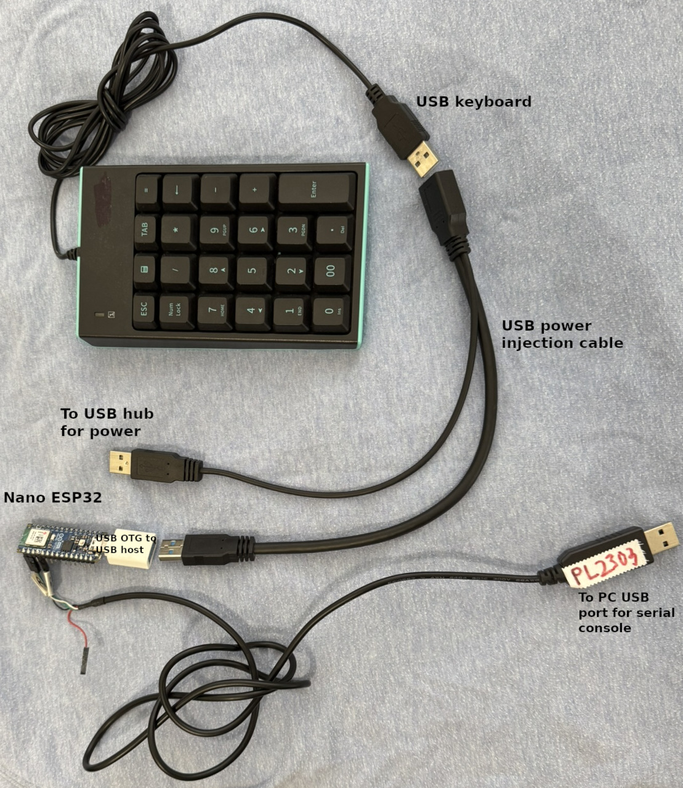

# Nano ESP32 USB host keyboard

An Arduino Nano ESP32 acting as a **USB host** for a normal USB keyboard,
using the **Espressif USB Host Library** (`esp_usb_host`, `usb/usb_host.h`) —
not TinyUSB. The raw eight-byte HID boot report is printed on a serial
console, and the sketch updates **over the air**, because the board's USB-C
port is busy hosting the keyboard.

```
kbd  -                 keys 00 00 00 00 00 00   (1 reports)
kbd  LS                keys 1E 00 00 00 00 00   (2 reports)
kbd  -                 keys 00 00 00 00 00 00   (3 reports)
```

Report byte 0 is the modifier bitmap (bit 0 L-Ctrl, bit 1 L-Shift, bit 2
L-Alt, bit 3 L-GUI, bit 4 R-Ctrl, bit 5 R-Shift, bit 6 R-Alt, bit 7 R-GUI).
Byte 1 is the reserved field. Bytes 2–7 are the six keycodes (raw HID usage
IDs — `04` = A, `1E` = 1, …). Identical back-to-back reports are suppressed,
so idle-repeat traffic does not flood the console.

**Two ways in.** Everything above the **Maintainer notes** rule is for Arduino
**IDE 2** users: which core to install, which board options to change, and how
to push an update over the air. Below that rule is maintainer material —
`arduino-cli`, `make`, the console monitor script, internals, and the stack
traps.

## Why this shape

| Constraint | Consequence |
|---|---|
| The ESP32-S3 USB peripheral can be a device **or** a host, never both | Board option **USB Mode = Debug mode (Hardware CDC)** — not the default. The sketch never calls `USB.begin()`; `Serial` (USB CDC) does not exist in this build. |
| The USB-C port hosts the keyboard, so DFU/CDC are unreachable | Every update after the first goes over Wi-Fi with `ArduinoOTA` — in IDE 2 that is **Tools → Port**, then Upload. |
| No USB serial for a console | `Serial1` (hardware UART1) on **D0 (RX, GPIO44)**, **D1 (TX, GPIO43)**, GND — a Prolific PL2303 USB-UART cable. 115200 8N1. |

The ROM/IDF boot console normally sits on UART0 at those same two pins;
`Serial1.begin()` re-routes them, so the boot log appears on the PL2303
cable until the app starts, and `Serial1` owns the line from then on.

## Hardware

| Item | Notes |
|---|---|
| Arduino Nano ESP32 | ESP32-S3; the USB-C connector is the host port |
| USB OTG cable, Type-C → Type-A host | the keyboard branch ends here |
| USB power injection cable (splits one socket into three plugs) | supplies VBUS; the ESP32-S3 does not source VBUS as a host |
| Prolific PL2303 USB-UART console cable | to D0 (RX), D1 (TX), GND |
| USB keyboard | bus-powered is fine with the injection cable |

In the photo, the cables are plugged to show the USB connectors.



Cable assembly — the order matters:

1. Plug the **keyboard** into the one connector of the power injection cable
   that accepts it (the keyboard's plug only fits that one).
2. The other two connectors are identical USB Type-A plugs. The cable has one
   **thinner leg** — plug the thinner leg into a **powered USB hub port**.
   That leg is the power source.
3. Plug the **remaining leg** into the **USB OTG Type-C → Type-A host cable**,
   and plug that cable's Type-C end into the Nano ESP32.

The keyboard now sees a powered bus, and the board is powered from the same
hub through the OTG cable. Getting the legs the wrong way round leaves the
keyboard on an unpowered bus — it never enumerates and the console never
prints a mount line.

> "USB power splitter cable" is the common search term; "USB power injection
> cable" is the accurate one.

## Software (Arduino IDE 2)

### Core to install

Open the **Tools → Board Manager** menu and install **Arduino ESP32 Boards**
(`arduino:esp32`) — the core that drives the Nano ESP32. This project is
pinned to and verified against **2.0.18-arduino.5**; Boards Manager may hand
you a newer release. The sketch compiles on both (the enum-filter callback is
behind a matching `#if`), but flash/RAM figures differ, so treat the numbers
in *Status* as 2.0.18-arduino.5 only.

Then pick the **Arduino Nano ESP32** board from the board dropdown in IDE 2's
right-hand sidebar; the **board options** in the table below are the other
entries in that same dropdown.

### Board options — one is not the default

| Board option | Set to | Why |
|---|---|---|
| **USB Mode** | **Debug mode (Hardware CDC)** | **Required, not the default.** The default "Normal mode (TinyUSB)" starts TinyUSB at boot and it claims the USB peripheral the host stack needs — the keyboard bus is then silently dead. |
| Pin Numbers | By Arduino pin (default) | The sketch uses the `D0`/`D1` Arduino names; the legacy "By GPIO number" menu also works, it just renames the constants. |
| Partition Scheme | With FAT partition (default) | OTA needs the second 3 MB app slot in this layout. |

### Credentials

The sketch reads `WIFI_SSID` / `WIFI_PASS` from a `credentials.h` in the
sketch folder, which is **not in git**. Create it before the first verify:
copy `credentials.example.h` to `credentials.h` and fill in your **2.4 GHz**
SSID and password — the ESP32-S3 radio is 2.4 GHz b/g/n only and will not see
a 5 GHz network.

### First upload — over USB, keyboard cable unplugged

The very first image has to go over the cable, so build the chain *after*
this step. If the Upload button cannot find the board, press the RESET tab
**twice** (the RGB LED starts flashing colours, then pulses green) and the
board enters the DFU bootloader.

### Every upload after that — over the air, keyboard still attached

The sketch runs `ArduinoOTA`, which advertises itself on Wi-Fi. In IDE 2:

1. Open **Tools → Port**. The dropdown's **top half lists the serial (USB)
   ports** your computer can see; the **bottom half lists the network ports**.
2. A board running this sketch appears in the **bottom half** as
   `nano-esp32-kbd.local` on port **3232** (its mDNS name — if your OS has no
   mDNS resolver, the same entry may show as its dotted-quad IP).
3. Select that entry and press **Upload**. IDE 2 pushes the compiled image to
   that network port; nothing about the keyboard cable changes, and the board
   reboots into the new image once the checksum passes. A failed push leaves
   the running sketch intact.

### The password dialog — type anything

The sketch sets **no OTA password**, but IDE 2 still opens a
**Configure and Upload** dialog with a **Password** field on the first push to
a network port — the core always declares that field, and the IDE has no way
of learning from the board that it is not needed. **Type any text** — the
server has no password, so it accepts anything — and press **Upload**. IDE 2
remembers it for that port, so later uploads to the same board don't prompt
again.

Bump `SKETCH_VERSION` near the top of the sketch before pushing — the console
status line prints it, which is how you prove the new image is the one
running.

### Watch it run

The console is the PL2303 cable on **D0 (RX), D1 (TX), GND** at **115200 8N1**
— it is a plain serial device, not the board, so any serial client works:

```
picocom -b 115200 <the Prolific serial device>     # or minicom, or PuTTY/Kitty
```

There is no reset circuit on that cable (Rx/Tx/GND only), so open the client
first, *then* press RESET if you want the boot log.

```
Nano ESP32 USB host keyboard — build 3 (esp_usb_host keyboard demo)
Chip ESP32-S3 rev 0, 240 MHz, flash 16 MB, PSRAM 8388608 bytes
Stack: ESP-IDF USB Host Library (esp_usb_host), not TinyUSB
Host ready. Plug in a USB keyboard (via power-injection cable).
Wi-Fi: connected — 192.168.1.98, RSSI -52 dBm, channel 5
OTA: listening on port 3232
[usbh] device 1: 046D:C313, low speed, configuration 1
[kbd] mounted: 046D:C313 low speed, interface 0, IN ep 0x81, mps 8
[kbd] modifier bits: LC LS LA LG RC RS RA RG — keys are raw HID usage IDs
kbd  LS                keys 04 00 00 00 00 00   (1 reports)
```

Typing `A` sends left-shift and `a` in one report (`LS`, `04`); the modifier
stays lit until the key is released.

### What the LEDs mean

| LED | Meaning |
|-----|---------|
| D13 (`LED_BUILTIN`) | Heartbeat — 180 ms half-period. Proves `loop()` runs. |
| RGB red | Associating with Wi-Fi |
| RGB green | Wi-Fi up, OTA listening on UDP 3232 |
| RGB blue | An OTA image is being written |
| RGB off | Wi-Fi down and retrying |

RGB LEDs are **active-LOW**. A first limited production run of this board has
green/blue inverted: set `RGB_SWAP_GB` to `1` if yours shows blue when it
means green. Keyboard state is on the console (and the status line), not the
LEDs.

## Troubleshooting

- **Keyboard never mounts, no `[usbh] device …` line** — the power-injection
  legs are swapped (see *Hardware*): the thin leg must go to the **powered
  hub**, and the keyboard must see that powered bus. A hub port that cannot
  feed both the keyboard and the board browns the board out — use a stronger
  powered hub, not the PC's own USB port.
- **No device events at all, bus looks dead** — the **USB Mode** board option
  was left at "Normal mode (TinyUSB)", so TinyUSB claims the USB peripheral
  the host stack needs. Set it to **Debug mode (Hardware CDC)** (see *Board
  options*). The sketch itself never calls `USB.begin()` or `Serial.begin()`.
- **The board powers up but browns out with the keyboard attached** — same
  cause: the hub port cannot supply VBUS to both.
- **Board stuck in a reboot loop, RGB cycling red/green/blue** — the
  bootloader's double-tap window is firing every cycle: the RESET tab is
  being pressed or held (the OTG/power-injection assembly leaning on it is
  the usual culprit), or the double-tap flag is stuck in RTC SRAM. A CPU
  reset preserves that flag and **an OTA reboot is a CPU reset**, so OTA can
  never clear it — only a full power cycle does: unplug the board, wait ~10
  s, replug, touch nothing.
- **Console silent from boot** — the PL2303 cable is a 3-wire cable with no
  reset circuit, so press RESET *after* opening the serial client. Check the
  wiring (board D0/RX ↔ the cable's Rx socket, board D1/TX ↔ its Tx socket,
  GND↔GND): some PL2303 clones **mirror the Rx/Tx sockets**, and crossed
  jumpers mean the board's output enters a dead socket — exactly zero bytes,
  not garbage. Garbage at 115200 means the clone defaults to 9600.
- **Board bricked / Wi-Fi credentials wrong** — unplug the keyboard cable,
  double-tap RESET until the RGB LED pulses green, then Upload over USB. The
  DFU bootloader runs before this sketch, so the host stack can never block
  that recovery path.

---

# Maintainer notes (Linux, command line)

Everything below this rule is `arduino-cli` and GNU-userland material: build
recipes, the console monitor script, internals, and the stack traps. IDE 2
users can stop here.

## Command line

```bash
make compile                  # arduino-cli compile --profile nano_esp32 .
make usb                      # DFU over USB: keyboard cable off, double-tap RESET
make ota IP=192.168.1.98      # esp_ota over Wi-Fi; IP= skips mDNS discovery
make monitor                  # tools/console.py on the Prolific by-id port
```

`sketch.yaml` pins the FQBN `arduino:esp32:nano_nora:USBMode=hwcdc` and the
core `2.0.18-arduino.5`, so `--profile nano_esp32` carries the board option
that IDE 2 makes you set by hand. `make ota` without `IP=` resolves
`nano-esp32-kbd.local` through the system resolver; `getent hosts` stalls ~10
s on this host when there is no mDNS answer, which is why the Makefile wraps
it in `timeout 5`.

## How it works

`setup()` installs the ESP-IDF host library (`usb_host_install()`) and
registers one client, then creates two FreeRTOS tasks — a daemon running
`usb_host_lib_handle_events()` and a client running
`usb_host_client_handle_events()` — mirroring the IDF `usb_host_lib` example.
A keyboard mount is a `USB_HOST_CLIENT_EVENT_NEW_DEV` event: the client task
opens the device, walks the active configuration descriptor for the first HID
interface with an interrupt IN endpoint, claims it, allocates one IN transfer
(endpoint-MPS sized) and submits it. The completion callback queues the
report and **immediately re-submits** — without the re-submit the keyboard
reports exactly once. `loop()` drains the queue, prints changed reports,
runs `ArduinoOTA.handle()` and the Wi-Fi watchdog.

The image is written to the idle app partition of
`app3M_fat9M_fact512k_16MB` (two 3 MB app slots) and only booted once the
checksum passes, so a failed push leaves the running sketch intact.

## Status

Builds clean with `--warnings all`: **776,613 B flash (24 % of 3,145,728) /
49,080 B RAM (14 % of 327,680)** (build 3); 17 `usb_host_*` functions link
from the core's prebuilt `libusb.a`. The sketch has been flashed and is
**confirmed running**: the console prints the status line every 5 s —

```
[    55 s] build 2 (esp_usb_host keyboard demo) | kbd=mounted 046D:C313 low reports=105 | net=connected | ip=192.168.1.98 rssi=-49 heap=269084 ota=nano-esp32-kbd.local:3232
```

so the host stack installed, Wi-Fi is up and OTA is listening. The keyboard
leg is verified as well — Logitech `046D:C313` at low speed, ~2 reports/s,
heap stable at 269 kB:

- [x] `make usb` → `make monitor`: boot banner, Wi-Fi up, `Host ready`.
- [x] Plug the keyboard in: `[usbh] device …` + `[kbd] mounted …` — a Logitech
      `046D:C313` at **low speed** (8 ms endpoint).
- [x] Type: modifier labels and keycodes track the report, reports keep
      coming (proves the re-submit re-arm) — ~2 reports/s at the low-speed
      endpoint, `LS`+`04` = Shift+A, `LC`+`04` = Ctrl+A, `LA`+`04` = Alt+A.
- [x] Unplug: `[kbd] removed`; replug: remounts without a reboot — watched
      directly. Pulling the keyboard printed `[usbh] IN transfer status 7`
      (`USB_TRANSFER_STATUS_NO_DEVICE`) then `[kbd] removed`, status lines
      went `kbd=none`, and replugging printed
      `[usbh] device 1: 046D:C313, low speed, configuration 1` +
      `[kbd] mounted: … interface 0, IN ep 0x81, mps 8` at uptime 285 s —
      the same boot, no reboot.
- [x] Bump `SKETCH_VERSION`, `make ota` **with the keyboard attached**: new
      build number on the console. Verified — build 2 booted at uptime 50 s
      with the keyboard cable still on and `kbd=mounted 046D:C313 low`.

## Command-line-only symptoms

- **`arduino-cli upload` for an external sketch dir needs `--fqbn`** — the
  profile comes from the sketch's own `sketch.yaml`, and a plain `compile`
  must run first: `--build-path` breaks the cache lookup
  (`Compiled sketch not found in ~/.cache/arduino/sketches/…`).
- **OTA push says `user input not supported in non interactive mode`** — pass
  `-F password=` even when the sketch has no OTA password (the `Makefile`
  does).
- **OTA push says `port not found: <ip> network`** — the running sketch has
  no `ArduinoOTA` listener (a probe build without it kills the network path),
  or the mDNS advertisement is slow: `--discovery-timeout 15s` fixes the
  latter. With no listener, recovery is double-tap RESET + `make usb`.
- **`getent hosts nano-esp32-kbd.local` stalls ~10 s** — this host has no
  mDNS in its resolver; the Makefile wraps the lookup in `timeout 5`, and
  `make ota IP=…` skips it. A raw mDNS probe (SO_TYPE 224.0.0.251, AF_INET
  socket bound to `("", 0)` with `settimeout`) returned no answers here, so
  the CLI is driven by the dotted-quad IP.
- **`tools/console.py` reads nothing while `minicom`/`cat` work** — the
  kernel's legacy pl2303 converter always reports **0 bytes waiting**, so
  pyserial's `in_waiting` cannot gate reads; the script block-reads with
  `timeout=0.2`. A second reader on the same tty (a stale background capture,
  or your own `minicom`) raises `device reports readiness to read but
  returned no data (… multiple access on port?)`; the script reopens the port
  instead of dying, but only one reader gets the bytes — kill the stale
  capture first.
- **Boot-loop evidence on the cable** — 98 cycles per 85 s, and `dmesg` shows
  a fresh USB attach every ~1.5 s.
- **Which USB identity the board shows is the state readout** (`lsusb` /
  `dmesg`) — `2341:0070` = an app owning the port as a *device* (TinyUSB CDC,
  the old blink_ota sketch); `303a:1001` "USB JTAG/serial debug unit" = the
  Arduino/IDF bootloader or the hwcdc console; a `new full-speed USB device`
  line with **no** `New USB device found` follow-up = a bare host PHY, i.e.
  this sketch in host mode. Absence of `2341:0070` is the alive signal.

## Reference

- Espressif USB Host: <https://docs.espressif.com/projects/esp-usb/en/latest/esp32s3/usb_host.html>
- Board: <https://docs.arduino.cc/hardware/nano-esp32/>
- Bootloader reset: <https://support.arduino.cc/hc/en-us/articles/9810414060188>
- OTA pattern and gotchas: sibling project `~/nano_esp32_blink_ota`
- Raw-report display idiom: sibling project `~/nano_r4_usb_host_keyboard`

## Acknowledgments

This sketch was developed with assistance from [OpenCode](https://opencode.ai).

## License

[MIT](./LICENSE) — see the `SPDX-License-Identifier: MIT` header at the top of
each source file.
